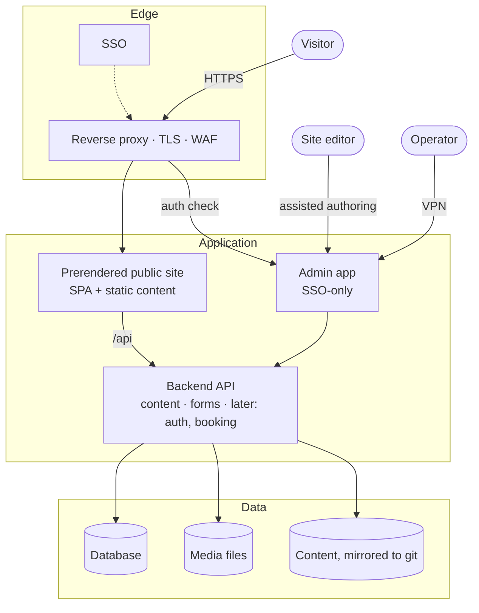

# Clinic Website — Architecture

A reference architecture for a small clinic's public website and blog, where the
person who keeps the site up to date is not technical, has never used git, a
terminal, or a code editor — and never should have to.

This repository is **documentation only**. It describes the design and the
decisions behind it. It contains no addresses, credentials, infrastructure
configuration, or personal data.

## The problem

- A small clinic has an existing website on a hosted website builder. They want
  to **own their content and their site**, keep publishing an established blog,
  and not be locked into a subscription or a proprietary editor.
- The person who edits the site is **not technical** and will not become
  technical. The system has to meet them where they are: they describe what they
  want in plain language; the site changes.
- The public site must be **fast, accessible (WCAG 2.2 AA), findable, and calm**
  — those are treated as features, not polish.
- Later phases (a members-only area, an online booking system) are known but out
  of scope for v1. The architecture must not have to be rebuilt to add them.

## The shape

## Contents

| Doc | Topic |
| --- | --- |
| [`docs/01-context.md`](docs/01-context.md) | Who it's for, constraints, the charter |
| [`docs/02-architecture.md`](docs/02-architecture.md) | Container view, the stack, why a backend |
| [`docs/03-content-pipeline.md`](docs/03-content-pipeline.md) | How a non-technical editor changes the site |
| [`docs/04-environments-and-promotion.md`](docs/04-environments-and-promotion.md) | dev → uat → prod, and what skips it |
| [`docs/05-security-and-privacy.md`](docs/05-security-and-privacy.md) | Threat model, hardening, data protection |
| [`docs/06-design-system-as-guardrail.md`](docs/06-design-system-as-guardrail.md) | Why the editor cannot break the design |
| [`docs/decisions/`](docs/decisions) | Architecture decision records |
| [`docs/glossary.md`](docs/glossary.md) | Terms |
