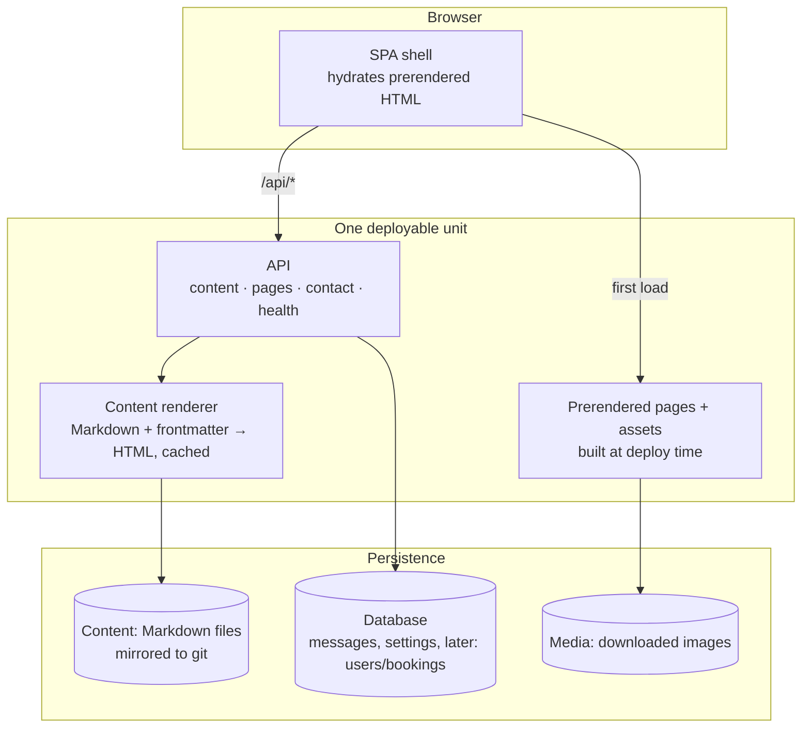

# 2 · Architecture

## Container view

## The stack

| Layer | Choice | Why |
| --- | --- | --- |
| Frontend | SPA framework + build-time prerender of all public content | Calm, fast first paint; content is in the HTML for crawlers and for no-JS readers |
| Styling | Utility CSS + a token-based design system | Tokens are CSS custom properties, which makes preset theming safe (ADR 0004) |
| Backend | A typed web framework with an ORM and migrations | Owns all dynamic behaviour; ready for auth and booking without a rewrite |
| Content | Markdown with frontmatter, rendered server-side and cached | Portable, diffable, greppable; not trapped in a database or a builder |
| Datastore | Single embedded SQL database to start, with a clean migration path to a server database | Right-sized for one small clinic; not a dead end |
| Packaging | One container image (frontend build → runtime), one service | Nothing to orchestrate |

## Why a backend at all

A pure static site would serve v1's public pages perfectly. It was still
rejected (ADR 0001):

- The **contact form** needs server-side validation, spam defence, and a stored
  record — not a third-party form service that phones home.
- Phase 2's **private area** needs sessions, authorisation, and gated content
  delivery.
- Phase 3's **in-browser authoring** needs an API that can write content and
  media safely.
- Phase 4's **booking** needs availability, reservations, and email.

Building the static-only version first and bolting a backend on later would mean
designing the data model twice. The backend is minimal in v1 but the schema and
API are designed with phases 2–4 in mind.

## Public content is prerendered

At deploy time, every public page and blog post is rendered to static HTML and
served directly by the edge. The SPA hydrates on top for interactivity (tag
filter, search). Consequences:

- First paint does not wait for JavaScript or an API round trip.
- Search engines and reader-mode get complete HTML.
- The API is not on the critical path for reading the site — if it is briefly
  down, the site still reads.

Content authored **after** the last deploy (new blog posts, events) is rendered
on demand and cached, so it appears without a rebuild. See
`03-content-pipeline.md`.
