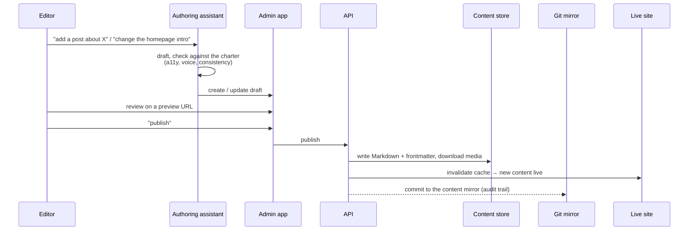
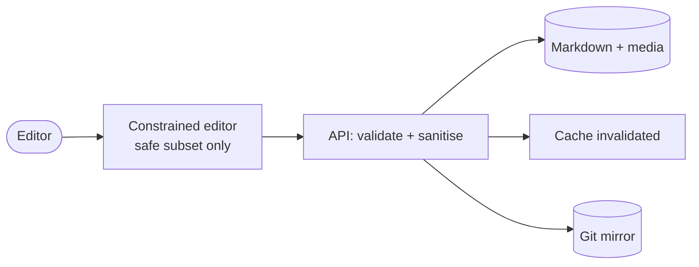

# 3 · Content Pipeline

The whole architecture exists to make one workflow safe and boring: a
non-technical person changes the site, often, without being able to break it.

## Two kinds of change

| Kind | Examples | Path | Gated? |
| --- | --- | --- | --- |
| **Content** | New blog post, edit a post, add an event, tweak page copy | Authored in the live admin app, published immediately | No — publishes on save |
| **Feature / design** | New page type, layout change, a new component, a theme preset | Code change, promoted through environments | Yes — CI + review + operator approval |

The line: **content is data the editor owns; features are code the maintainer
owns.** Making the editor wait for a deploy to publish a blog post would be
absurd. Letting the editor change layout code would break rule 3 of the charter.

## Content flow (v1: assistant-assisted)

## Content flow (phase 3: editor authors directly)

The assistant drops out of the loop. The editor writes in a constrained
in-browser editor — rich text mapped to a small, safe subset (headings,
emphasis, lists, quotes, images with required alt text, links). No raw HTML, no
style controls. Same publish → write → invalidate → mirror path.

## The git mirror

Every content change is committed to a git repository by the API, with the
editor as author and a generated message. This is **not** the publish
mechanism — publishing already happened. It is:

- an **audit trail** — who changed what, when, and the exact diff;
- a **backup** of content in a portable format;
- a **safety net** — any post can be restored to any past version.

Reviewability is preserved as history, not as a gate.

## Migration from the old site

The ~180 existing posts were imported once, up front:

- Each post's server-rendered body and its structured metadata (title, publish
  date, cover image) were extracted from the old site.
- Cover images were **downloaded and stored locally**, never hot-linked — the
  old host is not a dependency.
- Posts with only a video or only an image were handled as first-class cases,
  not skipped.
- The importer is idempotent and matches by slug, so it can be re-run to pick up
  anything published on the old site during the transition.
