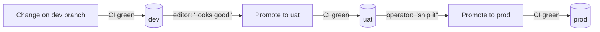
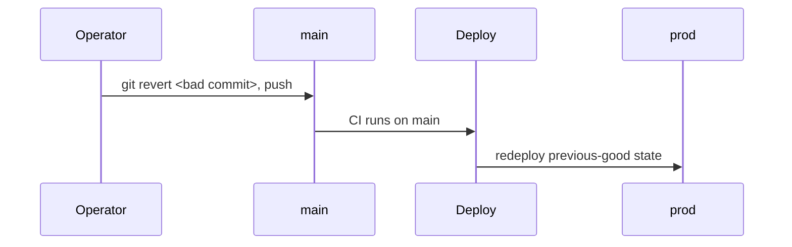

# 4 · Environments and Promotion

## Three environments

| Env | Purpose | Who looks at it |
| --- | --- | --- |
| **dev** | Where a feature or design change is built and first seen | Maintainer; editor for a "does this feel right?" check |
| **uat** | The editor's sign-off environment — realistic data, stable | Editor, then operator |
| **prod** | The public site | The world |

Each environment is the same image with different configuration and its own
data. Content does **not** automatically flow between them — prod content is
authored in prod (see `03-content-pipeline.md`); dev and uat carry a
representative sample.

## Promotion

- Promotion is a branch merge: `dev → uat → main`. Each merge triggers CI and, on
  success, a deploy of that environment.
- **CI green is mandatory** before any promotion.
- **prod is gated on the operator's explicit approval** — never automatic, never
  the editor's call alone.
- No hot edits to prod. A fix to prod is a change on `dev` that is promoted
  through, or a `git revert` that is promoted through.

## What each environment gate is actually checking

| Gate | Question |
| --- | --- |
| CI | Does it build, lint clean, pass tests, and meet the performance/accessibility budgets? |
| Editor on uat | Does it say what I mean and sound like the clinic? |
| Operator to prod | Is this safe, complete, and the right time? |

## Rollback

Data migrations are written to be reversible, so a rollback of code does not
strand the database.
