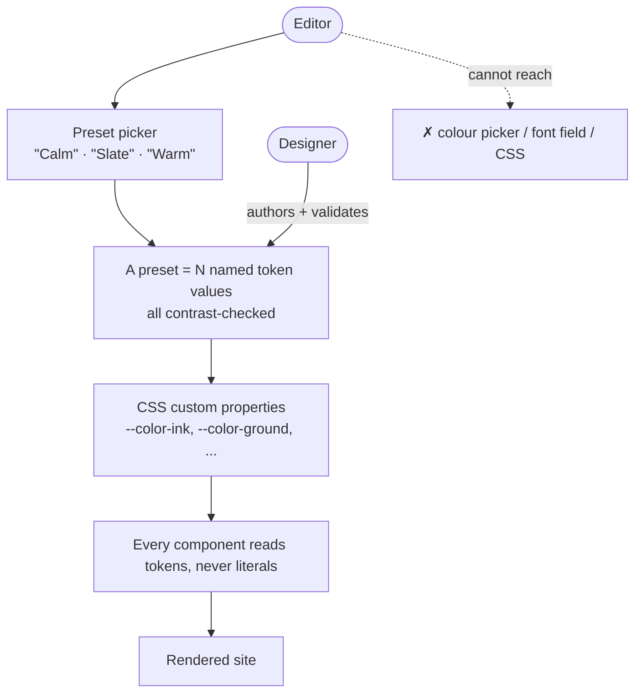

# 6 · The Design System as a Guardrail

## The idea

The editor can restyle the site. They cannot break it. Both are true because the
only styling controls they are given are **presets** — complete, pre-validated
sets of design tokens — and there is no path to a raw colour, font, or CSS field.

## Why it holds

- **A preset is a small, closed set of values.** Adding one is a designer task:
  pick the seed values, run the contrast checker, commit. The editor only ever
  selects among finished presets.
- **Components never use literal colours or sizes.** They reference tokens. So
  swapping the token set restyles everything, consistently, with no component
  aware that anything changed.
- **Contrast is validated at authoring time.** Every text/background pair in a
  preset is measured against WCAG AA before the preset ships. The editor cannot
  produce an illegible combination because no illegible combination exists in
  the options.
- **Type, spacing, and rhythm are not exposed at all.** They are part of the
  system, not a setting. One type scale, one spacing rhythm, site-wide.

## What the editor controls vs. what the system controls

| Editor controls | System controls |
| --- | --- |
| Which preset is active | The values in each preset |
| Page content, structure within a page template | Page templates, components |
| Which posts are featured | The blog layout |
| Images (with required alt text) | Image treatment, aspect ratios |
| — | Type scale, spacing, colour relationships, motion |

## Consequences

- Self-service theming (a future phase) is safe to build: it is "set the active
  preset", nothing more.
- "Can we just make this one heading pink?" is answered by the system, not by a
  one-off — a one-off is a smell and usually a sign the system needs a new,
  designed option.
- The site stays coherent as it grows, because coherence is structural, not a
  thing someone has to keep enforcing by hand.
